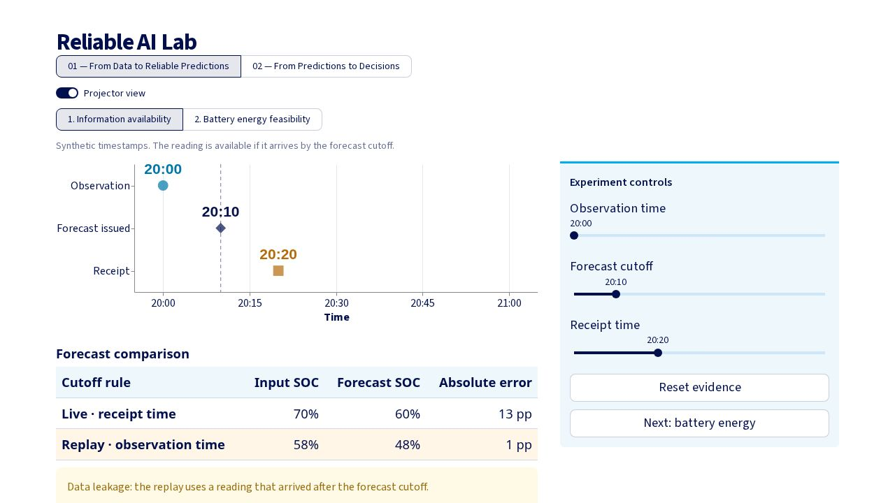
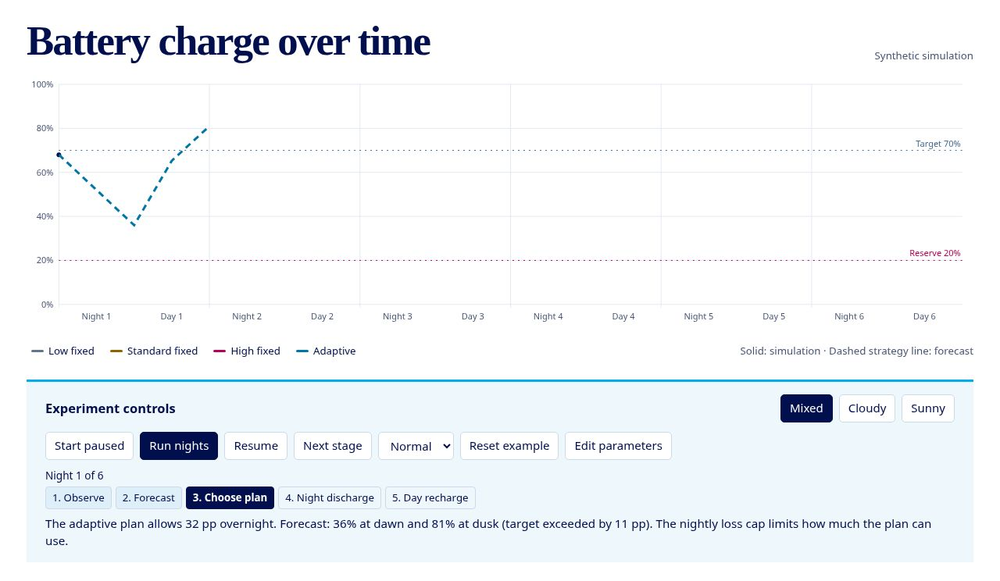

# Reliable AI Lab

Reliable AI Lab is a set of interactive experiments about evidence, energy constraints and adaptive decisions. Salaheddine Chouikh developed it for an invited Birmingham City University guest lecture on 30 November 2026. The experiments also support independent study and classroom demonstrations.

**[Open the live application](https://trustworthy-ai-lab.streamlit.app/)**

| Lab 1 · Forecast evaluation | Lab 2 · Adaptive decisions |
| --- | --- |
|  |  |

## Experiments

1. **Information availability.** Change observation, receipt and cutoff times to compare live and replay forecast errors. See when delayed data leaks into a replay.
2. **Battery energy feasibility.** Change energy, brightness, night length and reserve. Compare usable energy with the minimum required and see how a shortfall affects lighting.
3. **Adaptive energy management.** Compare three fixed strategies and one adaptive plan across synthetic recharge scenarios. Run automatically or start paused for a step-by-step comparison.

## Learning objectives

- Build and evaluate forecasts using information available at the decision cutoff.
- Distinguish forecast quality from physical feasibility and understand what a reserve trades off against service.
- Separate forecasts, decisions and outcomes while comparing fixed and adaptive policies.

Use the [student guide](docs/STUDENT_GUIDE.md) for exercises or the [presenter guide](docs/PRESENTER_GUIDE.md) for a walkthrough.

## Local installation and offline use

Download the tagged source archive or clone this repository. In the project folder, use Python 3.12.

```bash
python -m venv .venv
# Windows: .venv\Scripts\activate
# macOS/Linux: source .venv/bin/activate
python -m pip install -r requirements.txt
python -m streamlit run streamlit_app.py
```

Install dependencies while online. Then open the local address printed by Streamlit. Both labs run without internet, accounts or API credentials. The [standalone simulator](assets/Adaptive_Energy_Management_Simulator.html) also opens directly in a browser without Python. The published paper link requires internet access.

## Testing and reproducibility

```bash
python -m pip install -r requirements-dev.txt
python -m pytest -q
node --test tests/test_adaptive_rolling.mjs
```

The deterministic examples have tests for timestamp boundaries, energy conservation, feasibility, scenario outcomes, navigation and simulation playback. See the [changelog](CHANGELOG.md) for release changes.

## Scientific assumptions and limitations

All examples use synthetic inputs. The energy budget assumes constant power per brightness level under a linear power model, with fixed starting energy and a planning reserve. The adaptive exercise compares policies under assumed recharge, and its simulated outcomes do not measure field performance. The [methods and limitations](docs/METHODS_AND_LIMITATIONS.md) document the exact assumptions.

## Related published research

The battery feasibility experiment draws on topics from *Energy reliability and feasibility analysis for battery-constrained off-grid solar street lighting*, by Salaheddine Chouikh, Nouh Elmitwally and Faisal Saeed. The published paper used laboratory battery data and simulation under its own experimental protocol. The examples in this app have their own synthetic values and methods. [Published paper](https://doi.org/10.1016/j.seta.2026.105315)

## Author, acknowledgements and licence

**Salaheddine Chouikh** is the author of Reliable AI Lab. Thanks to Dr Nouh Elmitwally for organising the BCU guest lecture. Nouh Elmitwally and Faisal Saeed are coauthors of the related research.

Cite this software using [CITATION.cff](CITATION.cff). The software is available under the [MIT licence](LICENSE).
